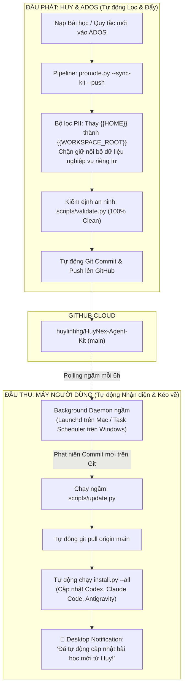

# Bài học: Khởi tạo HuyNex Agent Kit & Kiến trúc Đồng bộ Tự động Khép kín Hai đầu (Two-Way Auto-Sync)

- **Ngày ghi nhận**: 03/11/2026
- **Phạm vi**: Toàn bộ hệ sinh thái HuyNex, kho tài nguyên công khai HuyNex Agent Kit (`06_Cong_cu/huynex-agent-kit`), và các AI Agent Clients (Codex, Claude Code, Antigravity, Cursor).
- **Nguồn**: Xây dựng mới hoàn toàn theo yêu cầu của Huy nhằm biến toàn bộ tri thức, kỹ năng và quy tắc vận hành tinh hoa của HuyNex thành hệ thống mã nguồn mở độc lập, tự động hóa cập nhật 100% cho người dùng.

---

## 1. Bối cảnh & Vấn đề Cốt lõi Cần Giải Quyết

Trước ngày 03/11/2026, toàn bộ kỹ năng, bài học thực chiến và quy chuẩn vận hành của HuyNex nằm tập trung trong **ADOS** (`00_Tru_so/ADOS`). Hệ thống gặp 2 rào cản lớn:
1. **Rào cản chia sẻ an toàn (Safe Sharing Barrier):** ADOS chứa các nghiệp vụ hành chính đặc thù nội bộ, dữ liệu công tác cơ quan và đường dẫn máy cá nhân (`{{HOME}}`). Không thể công khai trực tiếp ADOS ra ngoài cộng đồng nếu chưa có cơ chế bóc tách khử trùng tuyệt đối.
2. **Rào cản cập nhật thủ công (Manual Sync Friction):** 
   - Phía người tạo (Huy): Sau khi viết xong bài học/quy tắc mới thường quên chạy lệnh đẩy lên repo chia sẻ.
   - Phía người dùng (User/Dev): Sau khi cài đặt ban đầu, người dùng hầu như không bao giờ nhớ việc phải gõ lệnh `git pull` để lấy cập nhật mới. Tri thức trên máy người dùng nhanh chóng bị lỗi thời.

---

## 2. Kiến trúc Giải pháp: HuyNex Agent Kit & Vòng lặp Khép kín Hai đầu

Hệ thống đã chính thức khai sinh **HuyNex Agent Kit** ([`06_Cong_cu/huynex-agent-kit`](file://{{WORKSPACE_ROOT}}/06_Cong_cu/huynex-agent-kit) — GitHub: `https://github.com/huylinhhg/HuyNex-Agent-Kit`) và thiết lập cơ chế tự động hóa 2 chiều:

### 2.1. Phía Người tạo (Creator Pipeline — ADOS $\rightarrow$ Kit)
- **Công cụ điều phối:** [`00_Tru_so/ADOS/governance/promote.py`](file://{{WORKSPACE_ROOT}}/00_Tru_so/ADOS/governance/promote.py) với cờ `--sync-kit --push`.
- **Cơ chế:**
  * Quét bài học trong `ADOS/governance/brain/lessons/`.
  * Tự động thay thế đường dẫn tuyệt đối cá nhân thành placeholder `{{WORKSPACE_ROOT}}`.
  * Kiểm tra danh sách cấm (Strict Blocklist): Nếu dính từ khóa nghiệp vụ đặc thù nội bộ $\rightarrow$ tự động giữ lại nội bộ.
  * Xuất file sang `huynex-agent-kit/lessons/`.
  * Chạy `validate.py` kiểm định an ninh.
  * Tự động `git commit` và `git push` thẳng lên GitHub.

### 2.2. Phía Người dùng (Consumer Pipeline — Kit $\rightarrow$ Clients)
- **Công cụ điều phối:** [`scripts/update.py`](file://{{WORKSPACE_ROOT}}/06_Cong_cu/huynex-agent-kit/scripts/update.py) và cờ `--auto-update` trong [`scripts/install.py`](file://{{WORKSPACE_ROOT}}/06_Cong_cu/huynex-agent-kit/scripts/install.py).
- **Cơ chế:**
  * Người dùng chỉ cần cài đặt 1 lần: `python3 scripts/install.py --all --auto-update`.
  * Hệ thống tự động thiết lập **Background Daemon** chạy ngầm (macOS Launchd, Windows Task Scheduler, Linux Cron).
  * Định kỳ mỗi 6 giờ và mỗi khi đăng nhập, daemon tự động fetch commit mới từ GitHub.
  * Khi có bản mới: Tự động kéo về, tự động nạp vào mọi client (`~/.codex/skills`, `~/.claude/skills`, `~/.gemini/config/skills`), và bắn thông báo Desktop Notification lên màn hình người dùng.

---

## 3. Quy ước Vận hành Từ nay về sau (Zero-Manual Standard)

1. **Tuyệt đối tự động:** Bất cứ khi nào Huy yêu cầu thêm/sửa bài học, kỹ năng hay quy tắc có tính chất phổ quát trong ADOS, Agent **BẮT BUỘC TỰ ĐỘNG** chạy luôn pipeline khử trùng và đẩy lên GitHub của HuyNex Agent Kit trong cùng phiên làm việc.
2. **Không để người dùng phải thao tác thủ công:** Mọi hướng dẫn cài đặt cho người dùng bên ngoài đều phải đính kèm tùy chọn `--auto-update` để kích hoạt cơ chế tự cập nhật ngầm.

---

## 4. Minh chứng Triển khai

1. **Repository HuyNex Agent Kit:** [`06_Cong_cu/huynex-agent-kit`](file://{{WORKSPACE_ROOT}}/06_Cong_cu/huynex-agent-kit) (Remote: `https://github.com/huylinhhg/HuyNex-Agent-Kit.git`).
2. **Bộ công cụ Cập nhật & Daemon:**
   - [`scripts/update.py`](file://{{WORKSPACE_ROOT}}/06_Cong_cu/huynex-agent-kit/scripts/update.py) (Kiểm tra git, pull ngầm, quản lý daemon macOS/Windows).
   - [`scripts/install.py`](file://{{WORKSPACE_ROOT}}/06_Cong_cu/huynex-agent-kit/scripts/install.py) (Hỗ trợ cờ `--auto-update`).
3. **Bộ công cụ Thăng hạng ADOS:**
   - [`00_Tru_so/ADOS/governance/promote.py`](file://{{WORKSPACE_ROOT}}/00_Tru_so/ADOS/governance/promote.py) (Hỗ trợ `--sync-kit --push`).
